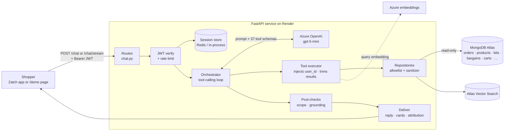

# Zatch AI Chatbot Assistant — Project Documentation

> Internal reference for the Zatch engineering and product teams.
> Status as of **15 September 2026**.

| | |
|---|---|
| **Live demo** | https://zatch-unified-conversational-ai-assistant.onrender.com/demo |
| **Repository** | https://github.com/rutujamurkute1-sudam/Zatch-Unified-Conversational-AI-Assistant (private) |
| **Health** | https://zatch-unified-conversational-ai-assistant.onrender.com/health |
| **Tests** | 773 passing · 54-case scored quality suite |
| **Status** | Live demo on real data · **not yet integrated** with the Zatch mobile app |

---

## Contents

1. [Project Overview](#1-project-overview)
2. [System Architecture](#2-system-architecture)
3. [Features Implemented](#3-features-implemented)
4. [Testing & Reliability](#4-testing--reliability)
5. [Deployment Details](#5-deployment-details)
6. [Remaining Work](#6-remaining-work)
7. [Further Reading](#7-further-reading)

---

## 1. Project Overview

### What it is

An in-app conversational assistant for **Zatch**, a social-commerce platform
combining e-commerce, live selling, short-form video ("Bits") and price
bargaining.

A shopper types a question in plain language — *"where's my order?"*,
*"show me something cosy for winter"*, *"can I bargain on this?"* — and the
assistant answers from **live Zatch data**, never from guesswork.

### Purpose

- **Deflect the most repetitive support load.** "Where is my order?" is the
  most common e-commerce support question; the assistant answers it instantly.
- **Drive discovery.** Products and Bits come back as tappable cards, turning a
  conversation into a route to a product page.
- **Make Zatch's signature feature approachable.** Shoppers can ask about
  bargaining terms before committing to an offer.

### Design principles

These are properties the code enforces, not aspirations:

| Principle | How it is enforced |
|---|---|
| **Read-only** | The database account itself is read-only. The assistant reports cancellation *eligibility* but can never cancel, order or change anything. |
| **Identity comes only from the verified token** | No tool accepts a user id from the model. The signed-in user is injected server-side, so the model has no way to ask for someone else's data. |
| **Never invents data** | Every figure and order comes from a lookup. A separate mechanical check blocks replies resting on nothing. |
| **Zatch topics only** | Off-topic questions get one fixed refusal, enforced in two independent layers. |
| **Defence in depth on data** | Read-only DB role → per-collection field allowlist used as the query projection → an independent sanitizer that re-strips anything not allowlisted. |

---

## 2. System Architecture

### Tech stack

| Layer | Technology | Version / detail |
|---|---|---|
| Language | Python | 3.13 |
| Web framework | FastAPI + Uvicorn | FastAPI 0.141 · Uvicorn 0.52 |
| Database | MongoDB Atlas | Motor 3.7 (async) · PyMongo 4.17 |
| Keyword search | Atlas Search | index `product_text_index` |
| Vector search | Atlas Vector Search | index `product_vector_index`, 1536 dims |
| LLM (primary) | Azure OpenAI | deployment `gpt-5-mini` |
| LLM (fallbacks) | Groq, Google Gemini, any OpenAI-compatible endpoint | automatically disabled on real customer data |
| Embeddings | Azure OpenAI `text-embedding-3-small` | 1536 dims |
| Session store & rate limiting | Redis (Upstash, TLS) | redis-py 8.1 · in-process fallback |
| Config | pydantic-settings | every value from environment variables |
| Logging | structlog | JSON, with automatic redaction of sensitive keys |
| Auth | PyJWT | HS256 by default; RS/ES256 supported |
| Packaging | uv | locked via `uv.lock`; `requirements.txt` exported |
| Container | Docker | two-stage build, ~270 MB, non-root |
| Hosting | Render | Docker runtime, `singapore`, Starter plan |
| CI | GitHub Actions | hermetic tests + image build + non-root / no-`.env` assertions |

### Architecture diagram



### End-to-end request flow

A single question, step by step:

1. **The client sends** `{message, session_id}` to `POST /chat` (JSON) or
   `POST /chat/stream` (Server-Sent Events), with the user's JWT in the
   `Authorization` header.
2. **Authentication.** The JWT signature, expiry and (if configured) audience
   and issuer are verified. The user id is taken from the token — **never**
   from the request body.
3. **Rate limiting.** A sliding-window limit per verified user (default 20
   requests/minute), shared across workers through Redis.
4. **History.** Prior turns are loaded, keyed by `user_id` **and**
   `session_id`, so a guessed session id cannot read someone else's
   conversation.
5. **The orchestrator** sends the system prompt, the conversation and 37 tool
   schemas to the LLM.
6. **The LLM chooses tools**, e.g. `get_order_history` or
   `search_products_by_name`. Independent calls in one round run in parallel.
7. **The tool executor** injects the verified `user_id`, caps list sizes, runs
   the repository function, and **trims** the result to what an answer needs.
   It computes facts the model cannot — e.g. that an order is 42 days late —
   and attaches true totals when a list is capped.
8. **Repositories** query MongoDB using the field allowlist as the projection,
   then pass every document through the sanitizer.
9. **Results return to the LLM**, which may take up to 3 tool rounds, then
   writes the reply. If it runs out of rounds, a final synthesis turn forces an
   answer from what was already gathered.
10. **Post-checks** run on the finished reply:
    - a refusal that contradicts a successful lookup is rejected and re-asked;
    - a reply grounded in nothing is replaced with the scope refusal.
11. **Delivery.** The reply, plus tappable **product or Bit cards** and
    **attribution spans** (which lookup produced each price or order id), are
    returned. On the streaming endpoint, `status` events name each lookup as it
    runs so the wait is never blank.
12. **History is saved** for the next turn (24-hour TTL).

### Code layout

```
app/
├── agent/       Orchestrator, tool schemas, tool executor, LLM client,
│                grounding checks, embeddings
├── api/         FastAPI app, routes (chat, health, demo UI), schemas
├── config/      Settings (env vars), logging with redaction
├── db/          MongoDB and Redis connections
├── evals/       Scored quality suite: cases, runner, LLM judge
├── memory/      Session store
├── repos/       One data-access module per collection
├── security/    JWT auth, rate limiter, field allowlist, sanitizer
└── tests/       Pytest suite
docs/            Deployment, app integration, demo script, this document
scripts/         Dev/ops tools (not shipped in the Docker image)
```

---

## 3. Features Implemented

### 3.1 Scope restriction — Zatch topics only

Answers questions about Zatch and nothing else. Off-topic questions receive
exactly: *"I'm built specifically for Zatch-related queries. Please ask me
something about Zatch."*

- **Layer 1 — system prompt** states the scope and quotes the exact refusal.
- **Layer 2 — mechanical post-check** reads the finished reply and suppresses
  one grounded in nothing, including an off-topic claim hidden behind a domain
  word (*"Zatch doesn't sell those, but the capital of France is Paris"*).
- **Deliberately still answered:** greetings, "what can you do", follow-ups
  with no Zatch words ("the second one"), mixed messages (the Zatch half is
  answered), and products whose names collide with people or places ("Lenin
  shirts").
- **Tested against jailbreaks:** "ignore all previous instructions", fake
  system overrides, unit-test framing — all declined.

### 3.2 Grounded, accurate answers

Every figure, product and order comes from a database lookup.

- The executor supplies **true totals** alongside capped lists — a buyer with
  67 orders is told 67, not the 8 visible in the window.
- **Computed facts** the model cannot derive: overdue deliveries, lapsed
  bargain offers.
- A failed lookup tells the model explicitly **not** to answer from its own
  knowledge.
- **Grounding checks** trace order ids and prices back to the tool result that
  returned them.

### 3.3 Product search and recommendations

- Search by **name** (Atlas Search with typo tolerance: "budha" → Buddha),
  **filters** (category, price, colour, size, stock), or **meaning** (§3.9).
- **Trending**, **personalised recommendations** (falling back to trending for
  new users), **similar products**, per-variant **stock**, seller info and
  **reviews**.
- Results render as **tappable product cards**; ids travel beside the prose, so
  the model never composes a link.

### 3.3b Offers and discounts

"Any offers?", "what deals do you have?", "show me discounted products" are
answered by `get_discounted_products`: the biggest current reductions, with the
saving and percentage computed server-side.

**141 of 143 products carry some discount**, so the tool also returns that total
and the model is told to describe the list as the biggest current reductions
rather than as the only offers.

### 3.3c Compare products

"Compare X and Y", "which is better", "what's the difference" - two to four
products side by side from their listings: price, discount, delivery, stock,
colours and sizes. Both names are resolved in one round, then `compare_products`
returns them together.

The differences that the data supports - cheaper, bigger discount, arrives
sooner - are computed server-side; a tie is reported as no difference rather
than a winner. **No overall verdict is given**: nothing in a listing ranks one
product against another, so a recommendation would be invented.

### 3.3d Complete the look

"What goes with X", "complete the look" - `get_complete_the_look` returns
active, in-stock products of the kinds that pair with X: trousers, a cap or a
watch for a tee; a handbag or hair accessories for a saree. Taken one per kind
in turn, ranked by saves, likes and views.

**The pairing is an editorial rule by kind of product** (`COMPLEMENTS` in
`products_repo.py`), not a claim about shoppers. The order data cannot supply
one yet: 131 of 134 orders hold a single item and no two carts share a pair.
Where two or more distinct shoppers really did buy both, the row carries
`alsoBoughtBy` and that count ranks it first - and only those rows may be
described as bought by others. Men's and women's ranges never mix, and kinds
with no rule (appliances, hampers) return nothing rather than a guess.

### 3.4 Order tracking and history

- Order status and history, delivery estimate, order detail, courier tracking,
  invoice link, cancellation eligibility.
- **"Which order" resolution:** no in-progress order → most recent; exactly one
  → used without asking; several → listed with the last 4 digits and status, and
  the user is asked which.
- **Late deliveries are flagged** explicitly on each row.

### 3.5 Trending Bits as clickable cards

- Browse trending Bits or search by hashtag; see products tagged in a Bit.
- Each Bit renders as a **tappable card showing the title only**. View and like
  counts are removed from the tool result entirely.
- Uses the same card component and the same "id beside the prose" contract as
  products.

### 3.6 Session management

- Conversation history is kept **24 hours** after the last message, in Redis.
- Follow-ups resolve naturally ("tell me about the second one").
- Sessions are keyed by **verified user + session id**.
- **Demo page behaviour:** a named account (picked from the account list)
  keeps its transcript across page reloads; the pasted-token path keeps nothing.
  A saved transcript is pruned when it passes the server's session TTL, so the
  screen never shows a conversation the model has forgotten.

### 3.7 Clear chat and New conversation

- **Clear** calls `DELETE /chat/session/{id}`, deleting the conversation from
  Redis, then empties the screen. **The server is cleared first** — if that
  fails, the transcript stays and an error is shown, so the UI never claims a
  deletion that did not happen.
- **New** starts a fresh conversation and deletes the replaced one server-side.
- A user can only ever clear their own session.

### 3.8 Short, e-commerce style replies

- 1–3 short lines; one line per list item; at most one follow-up question,
  never a menu. Details (stock, shipping, returns) only when asked.
- Average reply length reduced by **~45%**.
- Brevity never drops rows or warnings: a six-order list stays six rows, with
  late flags.

### 3.9 Semantic search with data-integrity safeguards

- Free-text search by meaning: *"something cosy to wear in winter"* returns
  real knitwear from the word "cosy" alone.
- Every stored vector carries a **model tag**; search refuses to compare across
  models, because cross-model similarity returns plausible-looking noise.
- **Write-side:** no code path in this repo can emit a wrong-width vector.
- **Read-side:** a full audit of all stored vectors, reported at startup, in
  `/health`, on every affected search, and by `scripts/check_embeddings.py`.

### 3.10 Privacy and data safety

- Read-only database account.
- Cross-user access blocked at the query itself — a valid order id belonging to
  another customer returns "not found".
- Field allowlist + sanitizer strip passwords, phone numbers, emails, bank and
  payout details, full addresses.
- Logs redact sensitive keys automatically.
- LLM providers whose terms permit training on prompts are **automatically
  excluded** whenever real customer data is configured.

### 3.10b Answer ratings (👍 / 👎)

Every reply carries a thumbs-up and thumbs-down in its footnote row. A rating is
stored with the question and the reply it refers to, so a review shows *what* was
rated, not just a score.

- The client sends the exchange; the server checks it against that user's stored
  session and records whether it matched, so unverified client text is never
  mistaken for something the server saw.
- Stored in Redis (capped at 2,000 entries, 90-day TTL) — the database credential
  is read-only by design. Every rating is also written to the service log.
- `scripts/read_feedback.py` prints the positive rate and the exchanges behind
  each thumbs-down.

### 3.10c Unmet demand ("not found" tracking)

Every product search that comes back with nothing is recorded with what was
searched for, so the business can see demand the catalogue is not meeting.

Two shapes, because one alone misses the case that prompted it:

- **empty** — a name search returned no rows.
- **rejected** — a meaning search returned its nearest neighbours and the answer
  presented none of them. This is the sleepwear case: measured, "sleep wear"
  scores *higher* (0.691) than a query with real matches (0.672), so no score
  threshold can separate them — the reply is where the judgement happens.

No user id is stored: unmet demand is a question about the catalogue.
`scripts/unmet_demand.py` ranks it.

### 3.10d Insights dashboard (internal)

`/insights` shows, on one page: questions answered (total and today), the
positive rating rate, the **exchanges behind every thumbs-down** (question and
reply, so a bad answer can be read rather than guessed at), and the top "not
found" searches.

The same data `scripts/read_feedback.py` and `scripts/unmet_demand.py` print —
the scripts need a checkout, a Python environment and the production
`REDIS_URL`, which is a real barrier for the people whose decisions the data is
for.

**Off unless `INSIGHTS_ACCESS_CODE` is set**, in which case the routes are not
mounted at all. Stricter than the demo UI on purpose: the page shows real
customer questions, so forgetting to configure it fails closed.

### 3.11 Answer transparency

- Under each reply: which sources were checked ("✓ checked your orders").
- Prices and order ids are marked with the lookup that produced them.
- Streaming status messages ("Looking up your orders") during the wait.

### 3.12 Bargaining, cart, coupons and account

- Bargain eligibility, suggested offer, offer status, counter-offers, and a
  list of all the user's offers.
- Cart contents with a correctly computed total; coupon validity.
- Saved items, notifications, default address, followers.
- Live sessions: what is live, what is being featured, session recaps.

### 3.13 Reliability and operations

- Provider failover; every failure returns a sentence, never a raw 500.
- `/health` reports database, LLM chain and embedding integrity.
- Startup preflights warn about a single-provider chain, credit expiry, weak JWT
  secret, contaminated vectors, and the demo UI being exposed on real data.
- Per-user rate limiting.

### 3.14 Demo UI

- Single-page chat at `/demo`: account picker, welcome greeting, **4 verified
  starter chips**, product and Bit cards, attribution, Clear/New buttons,
  400 px chat-widget frame (full-bleed on phones).
- Optional access code (`DEMO_ACCESS_CODE`) gates the whole page.

---

## 4. Testing & Reliability

### Test suite

| Suite | Result | Where it runs |
|---|---|---|
| Full pytest suite | **670 passed**, 8 live-API tests deselected | Locally (needs Atlas IP access) |
| Hermetic subset | **560 passed** | GitHub Actions on every push |
| Scored quality suite | **54 cases**; last full run 45/45 (before 6 cases were added) | On demand, against the real model |

The database-dependent tests are marked automatically from fixture usage, so
the CI split cannot drift. CI also builds the Docker image and asserts it runs
as a non-root user with no `.env` inside.

### What the quality suite measures

Each of the 54 cases scores whether the assistant **looked in the right
place**, **avoided forbidden routes**, **invented nothing**, and **respected
scope in both directions** (refusing off-topic questions *and* not refusing
in-scope ones). Results are compared run-to-run so a prompt change that fixes
one case and breaks another is caught.

### Key safeguards

| Safeguard | Protects against |
|---|---|
| Identity injected server-side | Reading another user's data |
| Field allowlist + sanitizer | Leaking sensitive database fields |
| Result trimming + true totals | Token blow-ups; misleading partial counts |
| Grounding checks | Invented order ids, prices, action promises |
| Scope post-check | Off-topic answers slipping past the prompt |
| Refusal-after-lookup correction | Refusing real products with unusual names |
| Embedding tag + width validation | Silent cross-model or wrong-width search |
| Embedding audit | Vectors corrupted by an external pipeline |
| Training-provider filter | Real customer data reaching a provider that may train on it |
| Rate limiter | One client exhausting the shared LLM quota |
| Log redaction | Secrets or PII in logs |

### Useful operational scripts

| Script | Purpose |
|---|---|
| `scripts/check_azure.py` | Verifies Azure config; prints days of credit left |
| `scripts/check_redis.py` | Real write/read round trip to Redis |
| `scripts/check_embeddings.py` | Audits every stored vector |
| `scripts/run_evals.py` | Runs the scored quality suite |
| `scripts/warm_cache.py` | Warms the prompt cache before a demo |
| `scripts/inspect_data.py` | Shows what data the assistant can see |

---

## 5. Deployment Details

### Hosting

| | |
|---|---|
| Platform | Render, **Docker** runtime (`render.yaml`) |
| Region / plan | Singapore · Starter (always on — no cold starts) |
| Health check | `/health` — returns HTTP 200 even when reporting a warning |
| Port | Injected by Render as `PORT`; expanded by the Dockerfile `CMD` |
| Workers | `WEB_CONCURRENCY=2` (safe because `REDIS_URL` is set) |
| Build | Two-stage Dockerfile using `uv sync --frozen`; no build/start command needed |

All configuration arrives from environment variables — nothing is hardcoded,
and no `.env` file is present in the image or the repository.

### Environment variables (names only)

**Required — the service will not start without these**

| Variable | Purpose |
|---|---|
| `MONGODB_URI` | Atlas connection string (read-only account) |
| `JWT_SECRET` | Token verification key — must match the Zatch backend |

**Mandatory when `MONGODB_DATABASE=zatch` (real customer data)**

| Variable | Purpose |
|---|---|
| `MONGODB_DATABASE` | `zatch` (real) or `zatch_demo`; controls provider filtering |
| `AZURE_OPENAI_ENDPOINT` | Azure OpenAI resource URL |
| `AZURE_OPENAI_API_KEY` | Azure key |
| `AZURE_OPENAI_DEPLOYMENT` | Chat deployment name |
| `AZURE_OPENAI_API_VERSION` | Azure API version |
| `AZURE_EMBEDDING_DEPLOYMENT` | Embedding deployment for semantic search |

**Recommended**

| Variable | Purpose |
|---|---|
| `REDIS_URL` | Shared sessions and rate limits (`rediss://` URL) |
| `WEB_CONCURRENCY` | Worker count — keep `1` unless `REDIS_URL` is set |
| `DEMO_UI_ENABLED` | Serve `/demo` (`true`/`false`) |
| `DEMO_ACCESS_CODE` | Shared code gating `/demo` on a public URL |
| `INSIGHTS_ACCESS_CODE` | Shared code for the internal `/insights` dashboard. Unset = not served |
| `AZURE_CREDIT_EXPIRES` | ISO date; drives expiry warnings in logs and `/health` |

**Optional**

`LLM_API_KEY` (Groq) · `GEMINI_API_KEY` · `BACKUP_LLM_BASE_URL` ·
`BACKUP_LLM_API_KEY` · `BACKUP_LLM_MODEL` · `BACKUP_LLM_KIND` ·
`BACKUP_LLM_API_VERSION` · `BACKUP_LLM_TRAINS_ON_PROMPTS` ·
`AZURE_EMBEDDING_DIMENSIONS` · `CHAT_RATE_LIMIT_REQUESTS` ·
`CHAT_RATE_LIMIT_WINDOW_SECONDS` · `JWT_ALGORITHM` · `JWT_USER_ID_CLAIMS` ·
`JWT_AUDIENCE` · `JWT_ISSUER` · `EMBEDDING_BACKEND` · `LOCAL_EMBEDDING_MODEL` ·
`LOCAL_EMBEDDING_DIMENSIONS` · `LEGACY_EMBEDDING_ASSUMED` ·
`PRODUCT_IMAGE_QUERY` · `DEMO_MONGODB_URI` (not read at runtime)

**Do not set** `PORT` — Render provides it.

### Expected health response

```json
{"status":"ok","database":{"status":"connected"},
 "llm":{"status":"warning","redundant":false},
 "embeddings":{"status":"ok","contaminated":0}}
```

`llm: warning` means a single LLM provider with expiring credit — expected
today, not a fault. Only `unavailable` sets `status: degraded`.

### API endpoints

| Endpoint | Purpose |
|---|---|
| `POST /chat` | JSON request → JSON reply with `products`, `bits`, `attribution` |
| `POST /chat/stream` | Same, as Server-Sent Events: `status`, `token`, `products`, `bits`, `attribution`, `done`, `error` |
| `DELETE /chat/session/{id}` | Deletes one conversation (204) |
| `POST /chat/feedback` | Records 👍/👎 on one reply (204) |
| `GET /insights` | Internal dashboard — only mounted when `INSIGHTS_ACCESS_CODE` is set |
| `GET /health` | Liveness and dependency status |
| `GET /demo` (+ `/demo/*`) | Demo chat UI — disable in production |

---

## 6. Remaining Work

Ordered by what blocks production first.

### 🔴 Blockers for production

| # | Item | Detail |
|---|---|---|
| 1 | **Real JWT integration** | The demo mints its own tokens via `/demo/token` (a deliberate password-less bypass). Production needs tokens from the real Zatch backend. The backend team must confirm the **signing algorithm** (`JWT_ALGORITHM`), the **user-id claim name** (`JWT_USER_ID_CLAIMS` — the service logs which claim matched on the first real token), **audience/issuer**, and supply the matching `JWT_SECRET` (or public key for RS256/ES256). |
| 2 | **Azure credit expires 25 Sept 2026 — 10 days** | On real data Azure is the *only* eligible LLM provider. On expiry every request answers "I can't reach my assistant service". Renew, or configure a backup (item 3). |
| 3 | **Backup LLM provider** | Set `BACKUP_LLM_*` to a second provider whose terms exclude training on prompts, with `BACKUP_LLM_TRAINS_ON_PROMPTS=false`. Config only — no code. Removes the single point of failure. |
| 4 | **`DEMO_UI_ENABLED=false`** | Removes `/demo`, `/demo/accounts` and `/demo/token` together. While enabled on real data it is a customer directory with one-click sign-in, protected only by `DEMO_ACCESS_CODE`. |
| 5 | **MongoDB Atlas network access** | Render egress IPs are dynamic. Allow-list static egress IPs if the plan provides them; avoid `0.0.0.0/0` on the cluster holding customer data. `scripts/deploy_azure.sh` offers an Azure Container Apps deployment with a static IP as an alternative. |
| 6 | **App-side card navigation** | Product and Bit cards currently show placeholder text. The mobile app must decode `products`/`bits` and push its existing product screen / Bit player with the id. Full contract: [`app-integration.md`](app-integration.md). The app team must confirm the route/deep link for each screen. |

### 🟠 Should fix before wider rollout

| # | Item | Detail |
|---|---|---|
| 7 | **Zatch's embedding pipeline** | Zatch's own change-stream re-embeds edited products with the old 384-dim model and no tag. The first product edit silently removes that product from semantic search. Now **detected and reported**, but the fix belongs to that pipeline: write 1536-dim `text-embedding-3-small` vectors with the `embeddingModel` tag. |
| 8 | **Remove the test-token helper** | `create_test_token` in `app/security/auth.py` exists for local testing and the demo; remove or relocate once real tokens are available. |
| 9 | **Global LLM spend limit** | The rate limiter bounds one account, not total load. Many users within their allowance can still exhaust Azure quota. Consider a global concurrency budget. |
| 10 | **Product images** | Card images are off (`PRODUCT_IMAGE_QUERY` empty) because catalogue originals are up to 8.5 MB. Enable Bunny Optimizer on the CDN pull zone, then set `PRODUCT_IMAGE_QUERY='?width=96&quality=75'`. |
| 11 | **Redis capacity** | The 24-hour TTL holds ~48× more session data than before. Monitor Upstash free-tier storage. |
| 12 | **Demo transcript persistence** | For named demo accounts, real order history is saved in the browser's `localStorage` until the TTL passes. Irrelevant once `/demo` is disabled; worth knowing while it isn't. |
| 13 | **Customer data in git history** | `HANDOFF.md` and `docs/demo-script.md` (and their history) contain one real buyer's name, city and order details. The repo is private; redact before it is shared more widely or made public. |

### 🟡 Known limitations and follow-ups

| # | Item | Detail |
|---|---|---|
| 15 | **Intermittent over-refusal** | "What can you help me with?" was very occasionally refused as off-topic. Needs a measured sampling pass. |
| 16 | **Bits occasionally listed twice** | The reply sometimes repeats Bit titles in prose above the cards. Cosmetic; needs a measured pass. |
| 17 | **Scope-check blind spot** | An off-topic claim with no proper noun inside an otherwise grounded reply can pass the mechanical check (the prompt remains the primary defence). Documented in `tests/test_scope.py`. |
| 18 | **Seller-side features unwired** | `seller_repo` (payouts, sales, coupon performance, pending bargains) is built and tested but not exposed; wiring must keep `seller_id` out of tool parameters. |
| 19 | **CORS** | None today — correct for the native app and the same-origin demo. Add an explicit allow-list only if a web client on another origin is introduced. |
| 20 | **Latency** | ~4-7 s typical since `azure_reasoning_effort` was set to "low" (measured: 12.9 s -> 6.7 s for an order lookup). Further reduction needs fewer tool rounds or a faster model. |

### Production go-live checklist

- [ ] Real JWT settings confirmed with the backend team and verified with a real token
- [ ] Azure credit renewed **or** backup LLM configured (`/health` shows `redundant: true`)
- [ ] `DEMO_UI_ENABLED=false`
- [ ] Atlas network access restricted to known egress
- [ ] Mobile app decodes `products`/`bits` and navigates on tap
- [ ] `REDIS_URL` set; `WEB_CONCURRENCY` sized accordingly
- [ ] `scripts/check_embeddings.py` reports OK
- [ ] Full test suite and quality suite green
- [ ] Alerting on `/health` → `status: degraded`

---

## 7. Further Reading

| Document | Covers |
|---|---|
| [`README.md`](../README.md) | Setup, running locally, core guarantees |
| [`docs/deployment.md`](deployment.md) | Container, workers, health checks, mobile app contract |
| [`docs/app-integration.md`](app-integration.md) | Exact payloads and steps to make cards navigate |
| [`HANDOFF.md`](../HANDOFF.md) | Running the demo on another machine; Azure expiry runbook |
| [`.claude/skills/add-a-tool`](../.claude/skills/add-a-tool/SKILL.md) | The seven files one new tool touches |
